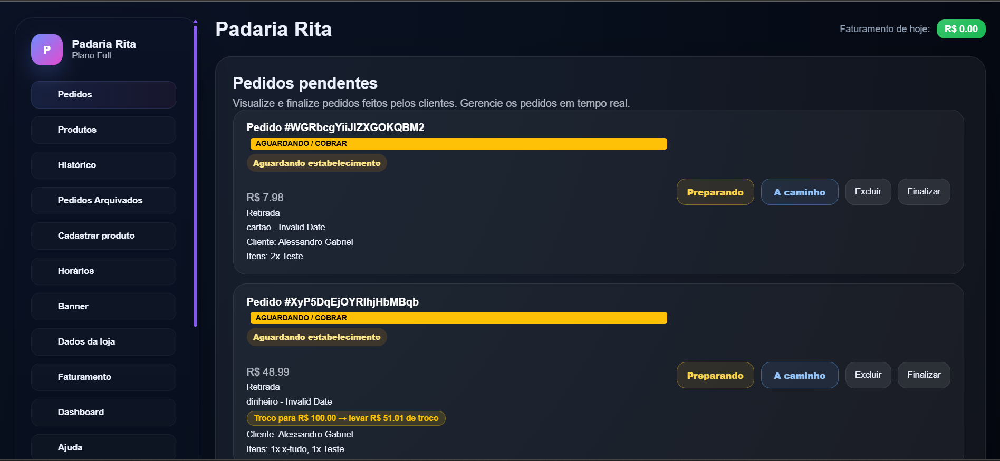
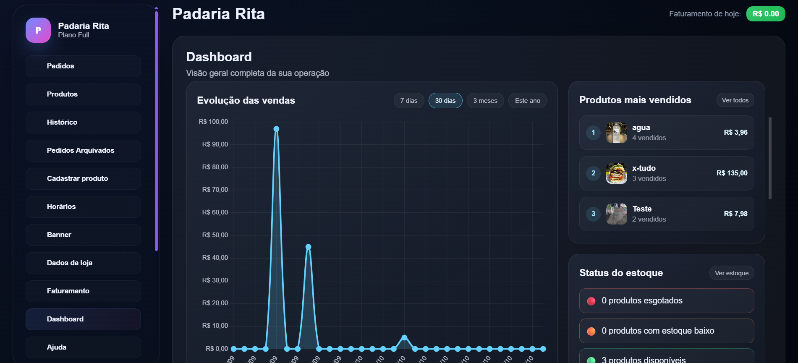
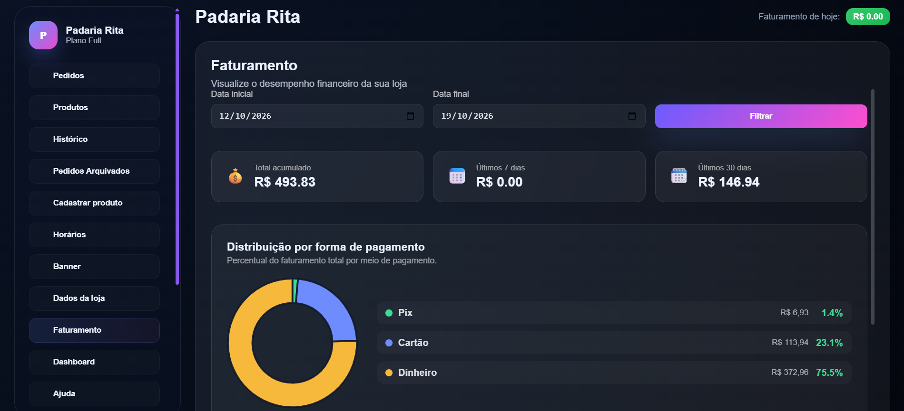

# Vendly Commerce | Plataforma SaaS de Gestão Comercial

<p align="center">
  <strong>Projeto Full Stack • Portfólio de Engenharia de Software</strong><br>
  Uma aplicação de gestão comercial desenvolvida para aplicar, na prática, conceitos de arquitetura, APIs, autenticação e regras de negócio.
</p>

<p align="center">
  
  
  
  
  
</p>

> **Sobre esta versão:** repositório destinado a **portfólio e estudo**, independente do sistema de produção. As configurações públicas apontam para serviços locais de demonstração. Não há instância comercial pública incluída neste repositório.

## Visão geral

O **Vendly Commerce** é um projeto independente de software para apoiar operações de pequenos estabelecimentos: cadastro de produtos, gestão de pedidos, acompanhamento de estoque, visualização de vendas e módulos de assinatura. Seu desenvolvimento envolve tanto a interface utilizada pelo estabelecimento quanto a API responsável pela lógica de negócio e integração dos componentes.

O objetivo ao publicar o código é demonstrar **experiência prática em desenvolvimento de software**, organização de um projeto Full Stack e investigação de problemas que surgem ao construir uma aplicação além de exercícios isolados.

## Prévia do sistema

### Painel de pedidos



Gerenciamento de pedidos com estados de atendimento, informações de itens e acompanhamento operacional. Identificadores e nomes de clientes foram ocultados na imagem.

### Dashboard



Visão geral das vendas, produtos mais vendidos e situação do estoque.

### Faturamento



Acompanhamento de valores por período e distribuição por forma de pagamento.

### Login e acesso ao painel


Interface de acesso à área administrativa.

<sub>As capturas ilustram o projeto em ambiente de desenvolvimento/testes e não representam indicadores comerciais auditados.</sub>

## Funcionalidades e desafios técnicos

| Área                                  | Implementação / aprendizado                                                                  |
| ------------------------------------- | -------------------------------------------------------------------------------------------- |
| **Pedidos**                           | Fluxo de acompanhamento e mudança de status; atualizações em tempo real com Socket.IO.       |
| **Produtos e estoque**                | Cadastro e acompanhamento de itens; regras de reserva de estoque para pedidos.               |
| **Dashboard e faturamento**           | Consolidação de informações para indicadores, gráficos e distribuição de pagamentos.         |
| **Autenticação e acesso**             | Autenticação de usuários e verificações de autorização em rotas do backend.                  |
| **Isolamento entre estabelecimentos** | Separação lógica de dados por estabelecimento (arquitetura multi-tenant).                    |
| **Pagamentos e assinaturas**          | Código de integração com provedores externos, webhooks e rotinas relacionadas a assinaturas. |
| **Qualidade**                         | Testes automatizados para regras de negócio, fluxos e cenários com emuladores.               |

### Aprendizados de engenharia de software

- Estruturar funcionalidades entre **front-end, API e persistência**, mantendo responsabilidades claras.
- Entender os cuidados de **autenticação, autorização e isolamento de dados** em aplicações multi-tenant.
- Tratar operações sensíveis como pagamentos, atualizações de pedidos e reserva de estoque como **regras de negócio**, e não apenas alterações visuais na interface.
- Investigar falhas, criar testes e evoluir o projeto com **Git e GitHub**.
- Separar configuração de **desenvolvimento** e **produção**, evitando dependências acidentais de serviços reais na cópia de portfólio.

## Tecnologias

| Camada                        | Tecnologias presentes no repositório                                          |
| ----------------------------- | ----------------------------------------------------------------------------- |
| **Interface**                 | HTML5, CSS3, JavaScript e módulos ES                                          |
| **Servidor/API**              | Node.js, Express                                                              |
| **Tempo real**                | Socket.IO                                                                     |
| **Persistência/autenticação** | Firebase Admin SDK, Firestore, Firebase Authentication e emuladores locais    |
| **Integrações**               | Mercado Pago e Cloudinary (código de integração; exigem configuração própria) |
| **Testes**                    | Node.js Test Runner e testes de integração com Firebase Emulator              |
| **Ferramentas**               | Git, GitHub, npm                                                              |

> O front-end desta cópia utiliza **HTML, CSS e JavaScript**; não é um projeto React/Next.js. As tecnologias acima correspondem aos arquivos desta versão pública.

## Organização do repositório

```text
vendly-commerce/
├── backend/
│   ├── config/           # Configurações de serviços
│   ├── database/         # Acesso a dados
│   ├── jobs/             # Tarefas programadas
│   ├── scripts/          # Utilitários para desenvolvimento e testes
│   ├── test/             # Testes automatizados e de integração
│   ├── utils/            # Regras e funções auxiliares
│   ├── server.js         # Servidor HTTP
│   └── package.json
├── frontend/
│   ├── assets/           # Ícones e recursos da interface
│   ├── css/              # Estilos e componentes visuais
│   ├── html/             # Páginas
│   └── js/               # Módulos e lógica do navegador
├── docs/
│   └── images/           # Capturas usadas neste README
└── README.md
```

## Como executar localmente

**Pré-requisitos:** Node.js e npm; Java é necessário para o emulador do Firestore. Utilize os **emuladores locais do Firebase**, sem conectar esta versão a um projeto Firebase de produção.

**1. Instale as dependências do servidor**

```bash
cd backend
npm ci
```

**2. Crie a configuração local**

Copie `backend/.env.local.example` para `backend/.env.local` e preencha as senhas de teste locais (`LOCAL_ADMIN_PASSWORD` e `LOCAL_SUPERADMIN_PASSWORD`) com pelo menos 12 caracteres. Mantenha esse arquivo fora do Git.

**3. Inicie os emuladores (terminal 1)**

```bash
cd backend
npm run emulator
```

**4. Inicie o backend local (terminal 2)**

```bash
cd backend
npm run dev:local
```

O arquivo `frontend/js/public-config.js` aponta, por padrão, para `http://127.0.0.1:3000`. Não altere esse endereço para a API comercial.

**5. Abra o front-end com servidor HTTP local**

Sirva a **raiz do repositório** em um servidor estático (por exemplo, Live Server), normalmente em `http://127.0.0.1:5500`, e acesse `frontend/html/login.html` por essa origem. Não abra o HTML diretamente via `file://`.

**Opcional — criar dados de demonstração:** com emuladores em execução, rode `npm run seed:local` dentro de `backend`, usando somente credenciais fictícias definidas em `.env.local`.

> Alguns recursos dependem de dados de exemplo e/ou de serviços externos não incluídos na cópia pública. Esta documentação descreve o ambiente local, não oferece uma implantação pronta para internet.

## Testes

No diretório `backend`:

```bash
npm test
```

Para os testes que utilizam os emuladores, inicie-os e depois rode:

```bash
npm run test:integration
```

O projeto também inclui verificações para regras relacionadas a pedidos, estoque, assinaturas e outros fluxos. A execução de integração exige configuração local compatível.

## Segurança e limites desta versão

- Não utilize credenciais reais, tokens de pagamento, contas de clientes ou um banco de produção nesta cópia.
- Não exponha as portas dos emuladores Firebase na internet.
- As URLs locais e configurações de exemplo foram separadas das de produção; **cada pessoa deve fornecer suas próprias configurações privadas**.
- A presença de testes e validações não representa certificação de segurança nem prontidão para uso comercial.
- Integrações externas e determinados recursos visuais podem exigir ativos e credenciais próprios.
- Consulte o histórico de alterações antes de tornar o repositório público; segredos adicionados em commits anteriores precisam ser tratados mesmo que tenham sido apagados dos arquivos atuais.

## Sobre o desenvolvimento

Projeto independente desenvolvido durante meus estudos em **Engenharia de Software**, com foco em transformar conhecimentos técnicos em funcionalidades reais, entender problemas de arquitetura e praticar a manutenção de código ao longo do tempo.

**Objetivo profissional:** atuar em uma primeira oportunidade de estágio em Desenvolvimento de Software, com abertura para Back-end, Front-end ou Full Stack.

---

<p align="center"><strong>Vendly Commerce</strong> · Projeto de portfólio e aprendizado em Engenharia de Software</p>
